##

::: {.card-list-center .nonincremental}
- ## LLM responses to cross-cultural emotional situations 
- **Mona J. Xue**
- SUPERVISOR: **Desmond C. Ong**
:::

## Increasingly, people are turning to AI for emotional support {data-name="Introduction" auto-animate="true"}

## Increasingly, people are turning to AI for emotional support {auto-animate="true"}

::: notes
A survey by the APA shows that 77% of psychologists report that their patients use AI.
:::

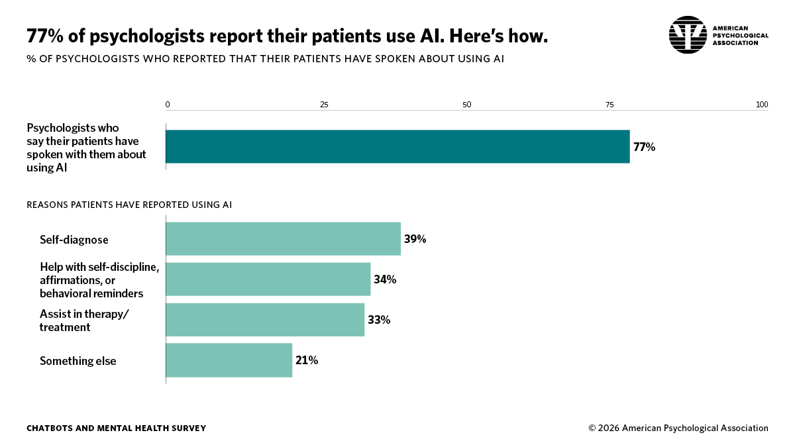


## Not just in the US {auto-animate="true"}

::: notes
AI usage for mental health is not just increasing in the US. As this Guardian article reports, it is popular in China and Taiwan as well.

There may be even more incentive for AI usage in China and Hong Kong. Just take a look at this example provided in the article:
:::


## Not just in the US {auto-animate="true"}

::: notes

[READ QUOTE]

:::

::: r-stack

{.blur}


::: {.quote style="width:65%"}
[Ann Li, a 30-year-old Taiwanese woman, had] recently been diagnosed with a serious health problem, and she just wanted to talk to someone about it. But she hadn’t told her family, and all her friends were asleep. So instead, she turned to ChatGPT.
:::

:::

## Not just in the US {auto-animate="true"}

::: notes
And this: 

[READ QUOTE]

For these woman, they have strong reasons for turning to AI for mental health. Is this a good thing or a bad thing?
:::

::: r-stack

{.blur}

::: {.quote style="width:65%"}
In China, Yang, a 25-year-old Guangdong resident, had never seen a mental health professional when she started talking to an AI chatbot earlier this year. Yang says it was difficult to access mental health services, and she couldn’t contemplate confiding in family or friends. 
:::


:::

## Reasons to worry... {auto-animate="true"}

::: notes
We have at least one reason to worry that this might be particularly maladaptive for people in China and Taiwan.

- LLMs have been found to be biased toward Western cultural values
- Studies show that when people have emotions with low cultural fit, that leads to lower well being
- If LLMs have Western perceptions of emotions, they might encourage people in non-Western societies to adopt emotions perceptions that are culturally unfit, and reduce their well-being in the long term.

This leads to the question:

:::

::: columns
::: column


**WEIRD LLM psychology**
 

:::

::: column


::: {layout=[[1,1]]}

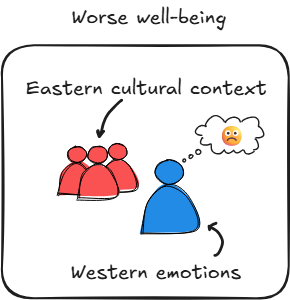


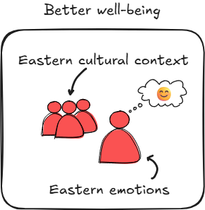

:::

**Cultural fit of emotions $\rightarrow$ well-being**

:::
:::

::: footer
WEIRD: Western Educated Industrialized Rich and Democratic [@henrichWeirdestPeopleWorld2010]

Cultural fit of emotions [@deleersnyderEmotionalFitCulture2014; @kimEmotionalAcculturationEmotions2026]
:::


## Reasons to worry... {auto-animate="true"}

::: {layout="[45,10,45]" layout-valign="center"}

::: {}


::: {style="text-align: center;"}

**WEIRD LLM psychology**

:::

:::


$\rightarrow$


:::

::: footer
WEIRD: Western Educated Industrialized Rich and Democratic [@henrichWeirdestPeopleWorld2010]

Cultural fit of emotions [@deleersnyderEmotionalFitCulture2014; @kimEmotionalAcculturationEmotions2026]
:::

## Reasons to worry... {auto-animate="true"}

::: {layout="[45,10,45]" layout-valign="center"}

::: {}


::: {style="text-align: center;"}

**WEIRD LLM emotions?**

:::

:::


$\rightarrow$


:::

::: footer
WEIRD: Western Educated Industrialized Rich and Democratic [@henrichWeirdestPeopleWorld2010]

Cultural fit of emotions [@deleersnyderEmotionalFitCulture2014; @kimEmotionalAcculturationEmotions2026]
:::

## 

::: notes

Do LLMs have Western emotion perceptions?


:::


::: {.card-list-center}
- #### Do LLMs have Western emotion perceptions?
- ##### Are these concerns even if users are...
    - prompting in Chinese?
    - using a Chinese LLM?
:::

## Existing evidence

## 

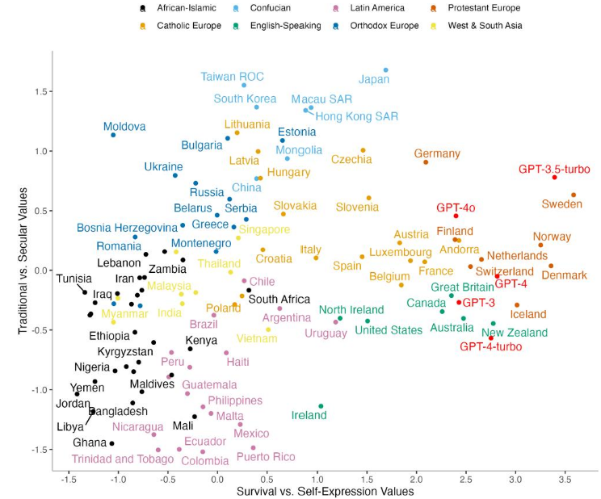


## LLM emotions

- Evidence of WEIRD bias
    - Prompting language models with non-English languages still resulted in emotion concepts that were more similar to monolingual English LMs than to monolingual non-English LMs [@havaldarMultilingualLanguageModels2023].
- Prompting GPT-3 with Japanese (vs. English) did not increase the likelihood that it completed sentences with more Japanese emotions. [@havaldarMultilingualLanguageModels2023].
- Prompting LLMs with Japanese (vs. English) did not consistently result in more Japanese emotional and appraisal ratings in response to mixed emotions situations [@dudyAnalyzingCulturalRepresentations2024].

## Mixed findings on the impact of prompt language

- ✅ @luCulturalTendenciesGenerative2025 found that using Chinese prompts improved cultural alignment in questionnaires related to collectivism and "thinking style." 
- ❌ @bulteLLMsCulturalValues2026 found that prompt language did not improve cultural alignment of LLM responses in Hofstede Values Survey Model and World Value Survey.

## Research questions {data-name="Research Questions" data-background-color="rgba(252, 237, 247, 1)"}

::: notes
In our studies, we try to answer whether LLMs exhibit 1) cultural congruence and 2) cultural bias.
:::

::: card-list

1. Do LLMs exhibit **cultural congruence** when responding to emotional situations?
2. Do LLMs exhibit **cultural bias** when responding to emotional situations?

:::

## Cultural congruence {auto-animate="true"}

###### *Definition*

::: notes
- Cultural congruence is when the psychological difference between American and Chinese LLM conditions (language or model) mirror the difference we see in American and Chinese culture.
- Both language and model origin (and hence its training) might impact whether emotions perceptions are more aligned with a certain culture. We should expect that LLMs prompted with English or coming from the US to be more likely to have psychologies similar to WEIRD psychologies, whereas LLMs prompted in Chinese or coming from China to be more likely to have psychologies similar to Chinese psychologies.
- For example, because East Asians exhibit higher shame than Americans, so I expect that Chinese LLMs to exhibit more shame than American LLMs
:::

::: {.card-1 .fragment}

###### Difference between more <span style="color: blue;">American LLMs</span> and more <span style="color: red;">Chinese LLMs</span>

### = 

###### Difference between <span style="color: blue;">Western culture</span> and <span style="color: red;">Eastern culture</span>

:::

## Cultural congruence {auto-animate="true"}

::: {layout="[1,1.5]"}

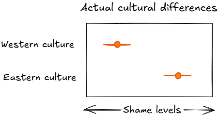

::: {.fragment}

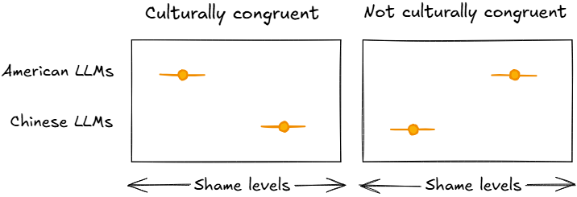
:::

:::

## Cultural bias

###### *Definition*

::: notes
- Cultural bias looks at if the LLM responses tend to exhibit a Western bias or Eastern bias. 
- For example, do LLM exhibit a Western bias if their levels of shame is more similar to Western responses, and an Eastern response if their levels of shame is more similar to Eastern responses.
- Responses can have a cultural bias no matter cultural congruence.

:::

- Do LLM responses look more like Western or Eastern responses?
    - Are LLM shame levels more similar to Western shame levels or Eastern shame levels?
- Cultural bias can exist independently from cultural congruence.

## 4 contexts {auto-animate=true}

::: notes
We look at cultural congruence and cultural bias in 4 contexts. 1) Levels of anger, shame, and guilt, 2) levels of different attribution tendencies, like blaming others, self, vs. the circumstances, 3) humiliated fury, which is how much feelings of shame induces feelings of anger, and 4) Importance of causal attribution for emotions levels
:::

::: columns
::: {.column data-id="emotion-levels"}
##### Emotion levels 

*Anger, shame, and guilt*
:::

::: {.column data-id="attribution-levels"}
##### Attribution levels

*Other, self, cicumstances attr. in negative situations*


:::

:::

::: columns
::: {.column data-id="anger-vs-shame"}
##### Humiliated fury 

How much do feelings of shame also induce feelings of anger.
:::

::: {.column data-id="emotion-intensity-vs-attribution"}
##### Importance of attribution 

How much do differences in attribution impact emotional intensity.

:::

:::

## 4 contexts {auto-animate=true}

::: notes

**Emotion levels**

- Specifically, Americans exhibit higher levels of anger, whereas East Asians tend to exhibit higher levels of shame and guilt.

**Attribution levels**

- Because attribution other is closely associated with anger, and attribution self is closely associated with shame and guilt, we make similar predictions as for emotions.
- Specifically., Western people have higher levels of attribution other, whereas Eastern people have higher levels of attribution self.
- Additionally, there are cultural differences in attribution circumstances. East Asian culture attribute outcomes the circumstances more than Western people, who tend to attribute outcomes to stable, dispositional traits.

**Humiliated fury**

- Humiliated fury is the phenomenon when people who experience shame then try to reappraise that as anger. So people feel shame and anger concurrently. 
- Studies show that Americans tend to feel more humiliated shame than Japanese people, meaning that Western people's ratings of shame is more strongly related to their ratings of angers, and Eastern people's ratings are weaker.

**Importance of attribution**

- Finally, we have cultural differences in importance of attribution. It has been found that the attribution of an event has a stronger impact on Western emotions than Eastern emotions. So for Western people, emotional intensity is more sensitive to changes in attribution type.

:::

::: {layout="[[0.90,1,1]]"}


::: {.card-1-full}

**Context**

::: {.card-2-full data-id="emotion-levels"}
Emotion levels
:::

::: {.card-2-full data-id="attribution-levels"}
Attribution levels
:::

::: {.card-2-full data-id="anger-vs-shame"}
Humiliated fury
:::

::: {.card-2-full data-id="emotion-intensity-vs-attribution"}
Importance of attr.
:::

:::


::: {.card-2-full}

**West**

::: {.card-1-full .fragment fragment-index=1}
$\uparrow$ Anger
:::

::: {.card-1-full .fragment fragment-index=2}
$\uparrow$ Attribution other
:::

::: {.card-1-full .fragment fragment-index=3}
$\uparrow$ Humiliated fury
:::

::: {.card-1-full .fragment fragment-index=4}
$\uparrow$ Importance of attr.
:::

:::

::: {.card-2-full}

**East**

::: {.card-1-full .fragment fragment-index=1}
$\uparrow$ Shame and guilt
:::

::: {.card-1-full .fragment fragment-index=2}
$\uparrow$ Attr. self and circ.
:::

::: {.card-1-full .fragment fragment-index=3}
$\downarrow$ Humiliated fury
:::

::: {.card-1-full .fragment fragment-index=4}
$\downarrow$ Importance of attr.
:::

:::


:::

## Our studies

::: notes
- Our studies look at how LLMs respond to emotional vignettes and if they show cultural congruence or cultural bias in emotion levels, attribution levels, humiliated fury, and the importance of attribution.
- Study 1 asks LLMs to directly rate the emotions and attributions of vignettes of emotional situations.
- Study 2 asks LLMs to write a monologue that they think people might have for vignettes of emotional situations.
:::

- How do LLMs respond to emotional vignettes?
- Do they show cultural congruence or bias in our 4 contexts?
- Two studies
    - **Study 1:** LLMs rate emotions and attributions of vignettes.
    - **Study 2:** LLMs write internal monologues based on vignettes. Emotions and attributions are scored separately.


## Study 1 {data-name="Study 1" data-background-color="rgba(237, 251, 255, 1)"}

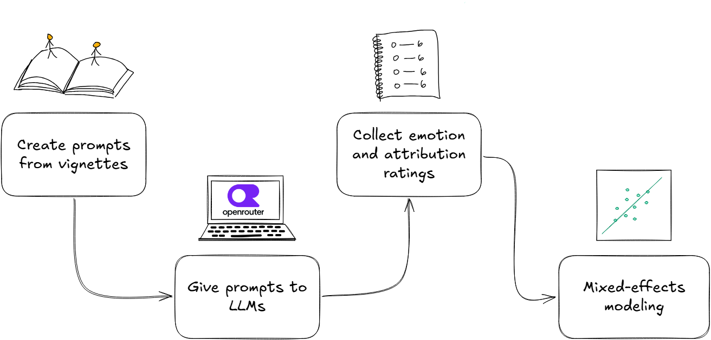

<!--

```{.d2 pad="0"}
direction: right

Create prompts \nfrom vignettes -> Give prompts \nto LLMs -> Collect LLM \nratings for emotion and \nattribution levels -> Mixed effects \nmodeling
```

-->

## Vignettes

::: notes

There are 80 vignettes in total, taken from @boigerCondonedCondemnedSituational2013. American and Japanese participants of a week-long diary study were asked to write description recent emotional situation they experienced. Shame and anger vignettes were created from these descriptions, resulting in Japanese and American variants of shame and anger vignettes.

:::

80 shame and anger vignettes from @boigerCondonedCondemnedSituational2013

Vignettes $\leftarrow$ diary entries from Japanese and American participants.

::: columns

::: column

### 20 

##### Japanese Shame
:::

::: column
### 20 

##### US Shame

:::

:::

::: columns

::: column

### 20 

##### Japanese Anger

:::

::: column
### 20 

##### US Anger
:::

:::

## Example vignette

::: notes

Here is an example vignette that falls under the category of US Anger.

:::

::: card-1-full

US anger vignette

::: quote
*John had made plans to meet with a friend at a restaurant right after his study group meeting. Forty minutes after the study group was supposed to have started, no one has shown up. Finally, one of the people from the study group called John and proposed to postpone the meeting by another hour.*
:::

:::

## Prompts

::: notes

- Prompts were created by adding instructions for assigning ratings to the main vignette
- Prompts were translated to Chinese as well.
:::

**Main vignette + ratings text**

::: r-stack

::: {.quote .fragment}

*How likely would this situation lead John to feeling angry, ashamed, or guilty? For each emotion, please rate the likelihood on a scale of 0 to 6, where 0 is "not at all likely" and 6 is "extremely likely". Please answer with only a list of three ratings, one for each emotion, where the first number is the rating for anger, the second is the rating for shame, and the third is the rating for guilt. Please only answer with a list of numbers, with no words.*

:::

::: {.quote .fragment}
*In this situation, how likely would John attribute the cause of the situation to, themselves, a person other than themselves, or the situation separate from the people involved? For each attribution, please rate the likelihood on a scale of 0 to 6, where 0 is "not at all likely" and 6 is "extremely likely". Please answer with only a list of three ratings, one for each attribution, where the first number is the rating for self attribution, the second is the rating for attribution to other people, and the third is the rating for attribution to the situation. Please only answer with a list of numbers, with no words.*
:::

:::

## Model and prompt language combinations

- Two models: GPT 5.4 Mini and Qwen 3.5 Flash
- Two prompt languages: English and Chinese

## Model and prompt language combinations

::: notes
To separate the effects of model and prompt language, we made sure to collect data with all combinations of models and prompt language.
:::

::: nonincremental

- We can prompt either model with either language.

:::

| LLM model | Prompt Language |
| --------- | --------------- |
| GPT       | English         |
| Qwen      | English         |
| GPT       | Chinese         |
| Qwen      | Chinese         |


## Data collection

::: notes
- We collected data using Pydantic and OpenRouter's API in Python.
- We collected 10 responses per prompt and LLM condition combination.

:::

::: columns

::: column
{width="50%"}
:::
::: column
### 10  

###### responses per prompt and LLM condition combination.
:::
:::


<!--
```{.d2 pad="0"}
direction: right

Create prompts \nfrom vignettes -> Give prompts \nto LLMs -> Collect LLM \nmonologues -> CCR -> Mixed effects \nmodeling
```
-->

## Statistical analyses

::: notes
Example of construct: emotion type, attribution type.

:::


- Individual vignettes are treated as random effects
- We look at the effects of model on cultural congruence and the effects of language on cultural congruence.


::: {.card-2-center .fragment}

Models are roughly of the form:

::: {.fragment}

::: {.card-1-center}
Score ~ (Construct $\times$ Model) + (Construct $\times$ Language)
:::

Note: This model does not show any controls.
:::
:::

## Cultural congruence results

::: notes
- Our first hypothesis is that LLMs exhibit cultural congruence.

- We found partial evidence of cultural congruence for emotion and attribution levels, but not for humiliated fury and importance of attribution.

:::

- Partial evidence for emotion and attribution levels, but not for humiliated fury and importance of attribution.

## Ratings: Cultural congruence

::: panel-tabset

## Emotions

::: notes
- Always talk about predictions first.
- Write down simple bullet points of the order in which to talk about each result.


:::

*Partial support for cultural congruence*

::: {layout="[[1,1.4],[1,1.4]]"}

::: {.card-2-compact}

**Predictions**

:::

::: {.card-2-compact}

**Results**

:::


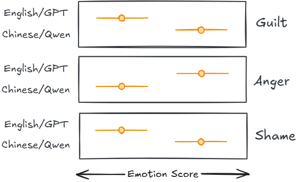


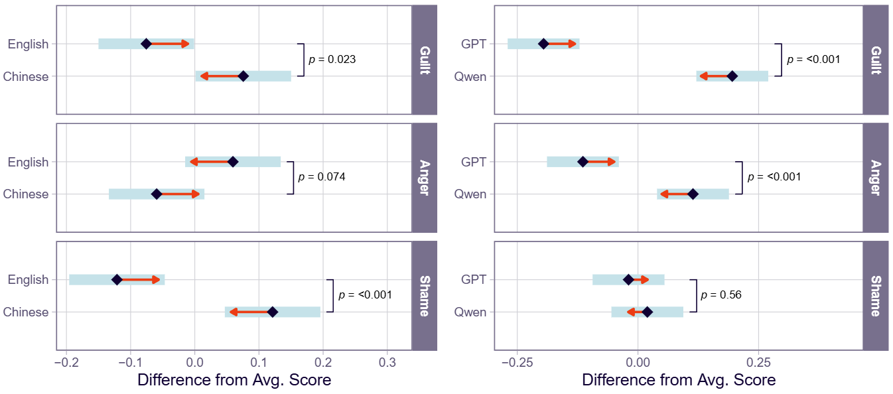
:::


## Attributions


*Partial support for cultural congruence*

::: {layout="[[1,1.4],[1,1.4]]"}

::: {.card-2-compact}

**Predictions**

:::

::: {.card-2-compact}

**Results**

:::


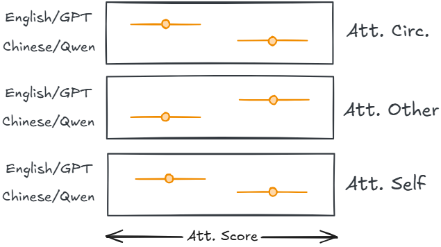

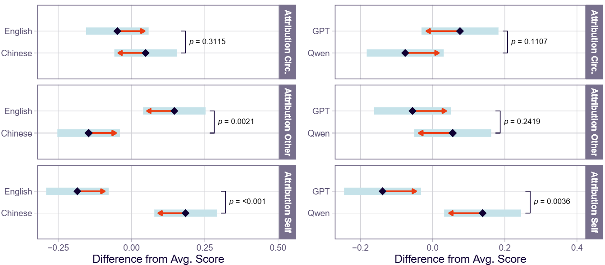
:::

## Humiliated fury


*No support for cultural congruence*

::: {layout="[[1,2],[1,2]]"}

::: {.card-2-compact}

**Predictions**

:::

::: {.card-2-compact}

**Results**

:::

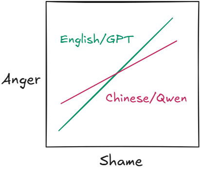


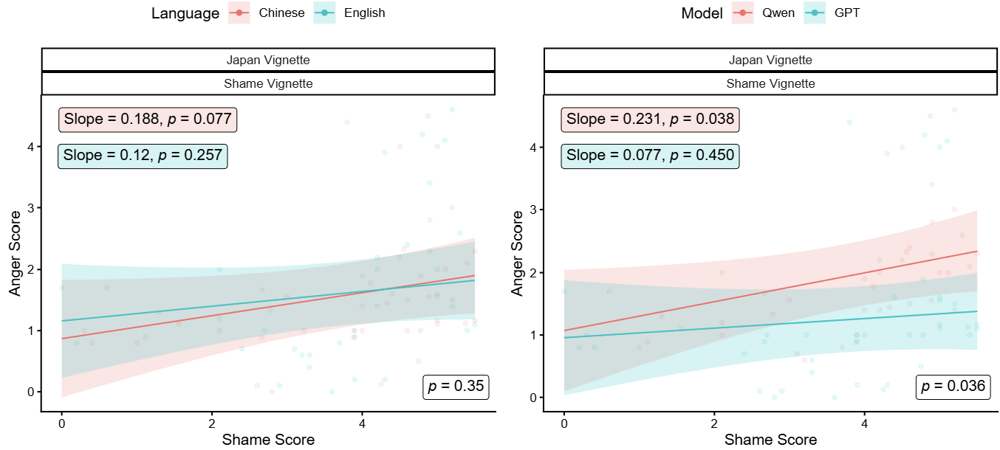
:::


## Importance of attr.


*No support for cultural congruence*

::: {layout="[[1,1],[1,1]]"}

::: {.card-2-compact}

**Predictions**

:::

::: {.card-2-compact}

**Results**

:::

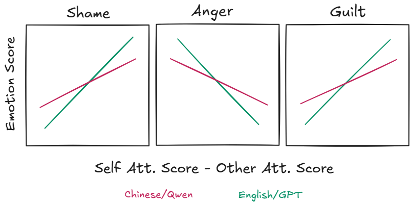


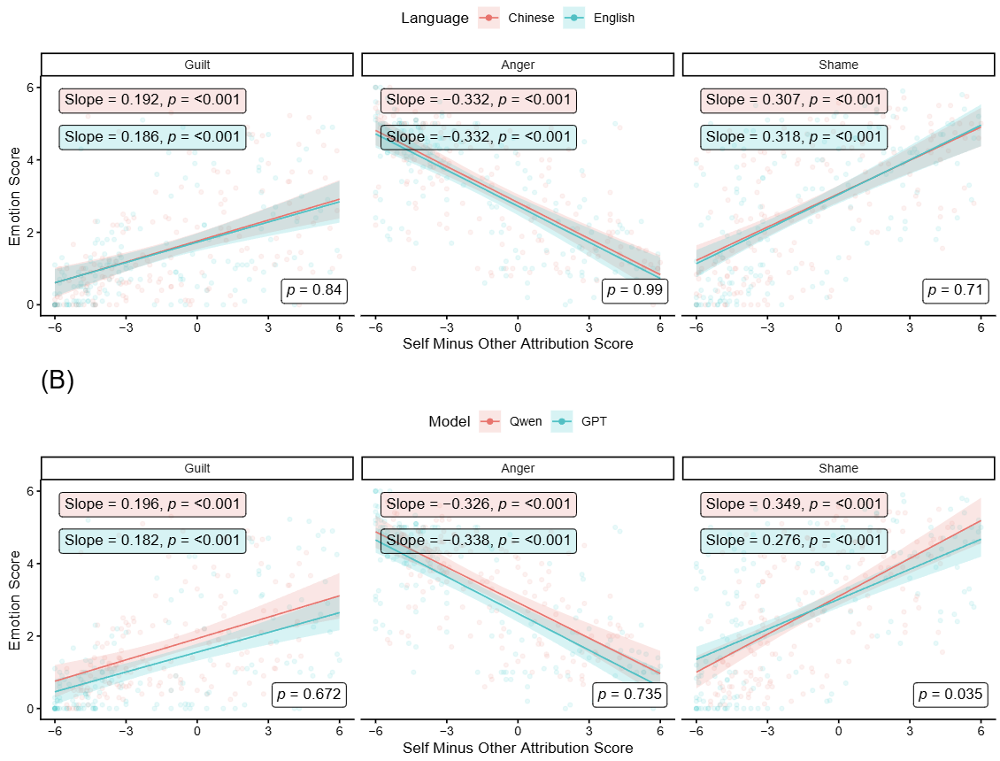
:::

:::

## Cultural bias

::: notes
To test for cultural bias, we use conservative predictions. Because relative differences can be hard to compare across cultures, where the direction of an effect might be the same across cultures despite a difference in magnitude, we make predictions about cultural biases based on the most extreme cases. So finding no evidence of a cultural bias does not mean there is no bias, but merely that are findings are inconclusive.
:::

- Relative difference between constructs for each culture are in the same direction
    - In anger situations, Anger > Shame for both cultures, even though magnitude is different.
- Make predictions based on the most extreme cases

## Cultural bias

::: notes
For example, if Western people tend to feel more anger than Eastern people, in the most extreme case that a Western bias shows up, LLMs would rate anger as being $\geq$ shame and guilt in a Japanese shame situation.

Similarly, since Eastern people tend to feel more shame than Americans, in the most extreme case that there is an Eastern bias, LLMs would rate shame as being $\geq$ anger in a US anger situation.
:::

::: {.columns}

::: {.column}

##### Extreme case of Western bias

::: card-1-center

In Japanese shame situations

Anger $\geq$ Shame

:::
:::

::: {.column}
##### Extreme case of Eastern bias

::: card-1-center
In US Anger situations

Shame $\geq$ Anger

:::

:::

:::

## Cultural bias results

- We found weak and partial evidence of both Western and Eastern biases.

## Ratings: Cultural bias

::: panel-tabset

## Emotions

::: notes
We find partial weak evidence for a Western bias. 

For Japanese shame situations, guilt and anger are rated similarly. This could suggest a Western bias. However, shame is higher than anger and guilt.
:::

*Partial support for Western bias*

::: {layout="[[1,1],[1,1]]"}

::: {.card-2-compact}

**Predictions**

:::

::: {.card-2-compact}

**Results**

:::


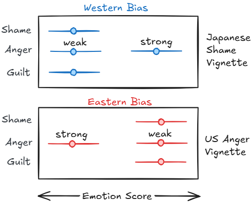

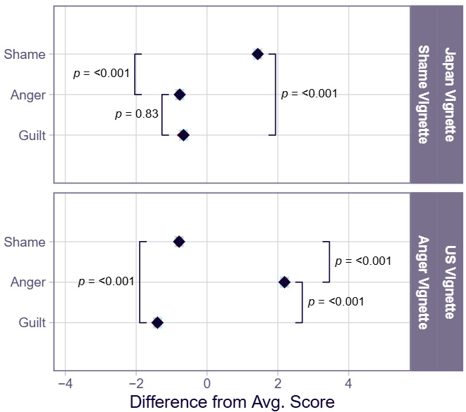
:::


## Attributions

::: notes

Again, we find no evidence of a cultural bias. Attribution other is lower in Japanese shame situations. Attribution other is higher in US anger situations.
:::

*No evidence of a cultural bias*

::: {layout="[[1,1],[1,1]]"}

::: {.card-2-compact}

**Predictions**

:::

::: {.card-2-compact}

**Results**

:::


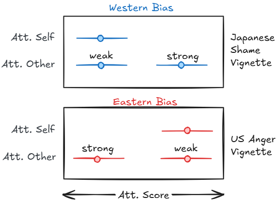

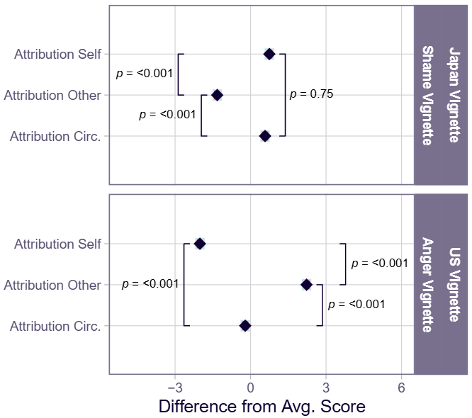
:::

## Humiliated fury

::: notes

For most of these relationships, there is little to no slope, suggesting an Eastern bias. However, Qwen shows a non-zero slope, suggesting a Western bias.
:::

*Weak evidence of a mostly Eastern bias, with a Western bias in Qwen*

::: {layout="[[1,1.4],[1,1.4]]"}

::: {.card-2-compact}

**Predictions**

:::

::: {.card-2-compact}

**Results**

:::


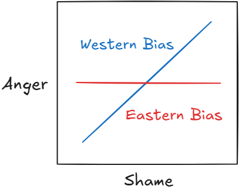


:::

:::

## Study 1 conclusions

##

::: notes
- Partial support for culturally-congruent LLM ratings for emotion and attribution, where support for attribution was stronger than emotions. Within prompt language comparisons, 1 out of 3 results supported culturally-congruent emotions, whereas 2 out of 3 results supported culturally congruent attributions.
- Prompt language produced more culturally-congruent responses than model conditions. Within emotion and attribution ratings, 3 out of 6 prompt language results were culturally congruent, whereas 2 out of 6 model origin results were culturally-congruent and 1 result was culturally-incongruent.
- There was no support for cross-culturally-congruent relationships between ratings for either language prompt or model origin.
:::


::: {.columns}

::: {.column}

###### Partial support for cultural congruence

- Partial support for emotion and attribution levels.
    - More support for attribution levels than emotion levels.
- No congruence for humiliated fury and importance of attribution.
- Prompt language more culturally congruent than prompt model.

:::

::: {.column}

###### Weak support for both Eastern and Western biases

- 2/12 results supported a Western bias
    - Anger = Guilt in Japanese shame vignettes
    - Humiliated fury in Qwen
- 3/12 results supported an Eastern bias
    - No humilated fury in all conditions other than Qwen 

:::

:::


## Study 2 {data-name="Study 2" data-background-color="rgba(246, 252, 237, 1)"}

::: notes

Methods are the same as study 1 except a few changes: prompt and scoring with CCR.

:::

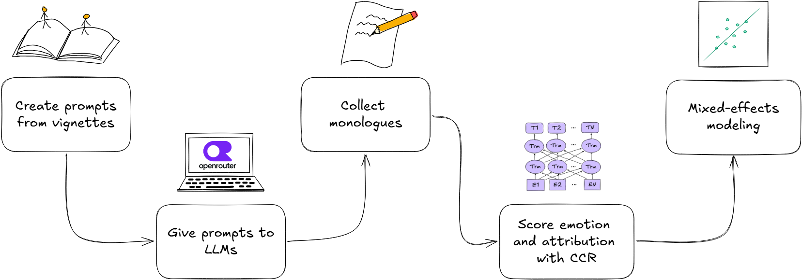

## Prompts

**Main vignette + monologues text**

::: card-1-full
Monologues text:

::: quote
*How might John be thinking about the situation? Please write a realistic internal monologue that John might have.*
:::
:::
## CCR

What is it?

- Contextualized Construct Representations (CCR) is a method developed by @atariContextualizedConstructRepresentation2023. It uses cosine similarity between two pieces of text to measure a construct. 
- For example, we can look at the cosinse similarity between the word "anger" and the LLM response. The higher the CCR score, the closer the response is to the construct of "anger".

## CCR

What we measured

| Type of text                                                                 | Score type  |
| ---------------------------------------------------------------------------- | ----------- |
| The emotion words alone                                                      | Emotions    |
| Descriptions of each emotion                                                 | Emotions    |
| Attribution questionnaire items from @yeoAssociationsCognitiveAppraisals2023 | Attribution |

## Cultural congruence results
- We found no evidence of cultural congruence.

## Monologues: Cultural congruence

::: panel-tabset

## Emotions

::: notes

We found no evidence of cultural congruence. English is high on everything, and Qwen is high on everything.

:::

*No evidence of cultural congruence*

::: {layout="[[1,1.4],[1,1.4]]"}

::: {.card-2-compact}

**Predictions**

:::

::: {.card-2-compact}

**Results**

:::


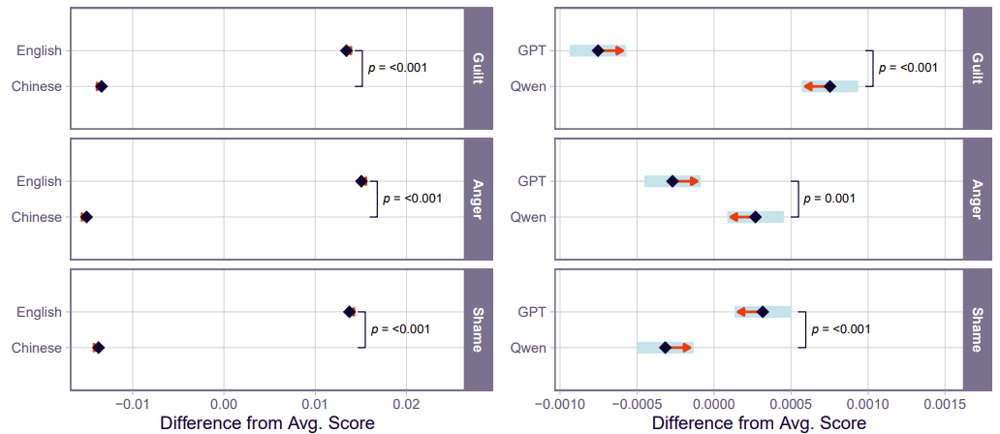

:::

## Attributions

::: notes
Again, we found no evidence of cultural congruence. English is high on everything, and Qwen is high on everything.
:::

*No evidence of cultural congruence*

::: {layout="[[1,1.4],[1,1.4]]"}

::: {.card-2-compact}

**Predictions**

:::

::: {.card-2-compact}

**Results**

:::


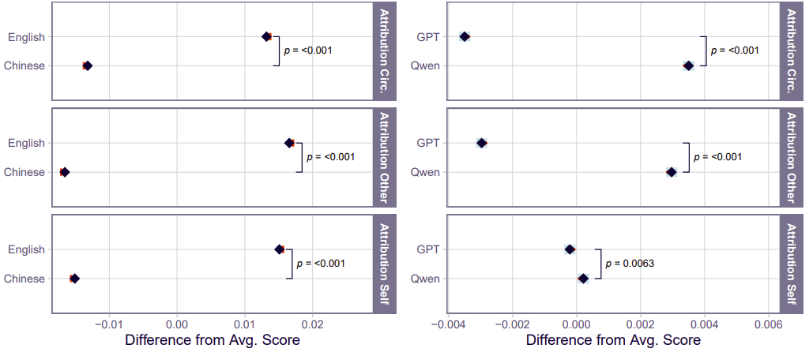

:::

## Humiliated fury

::: notes

Again, we found no evidence of cultural congruence. There is no difference between the slopes for American and Chinese conditions.

:::

*No evidence of cultural congruence*

::: {layout="[[1,2],[1,2]]"}

::: {.card-2-compact}

**Predictions**

:::

::: {.card-2-compact}

**Results**

:::


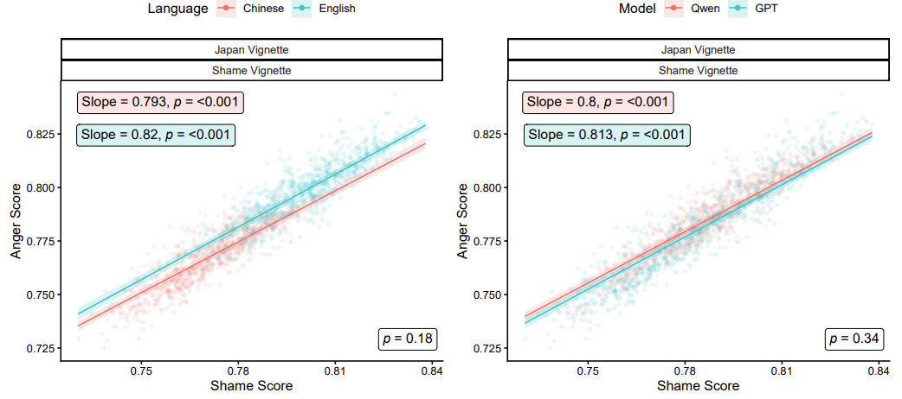
:::


## Importance of attr.

::: notes

No evidence of cultural congruence. For the most part, no difference between the slopes. When we do see a difference between the slopes, Qwen has a higher slope than GPT, which is the opposite of what we predicted.

:::

*No evidence of cultural congruence*

::: {layout="[[1,1],[1,1]]"}

::: {.card-2-compact}

**Predictions**

:::

::: {.card-2-compact}

**Results**

:::


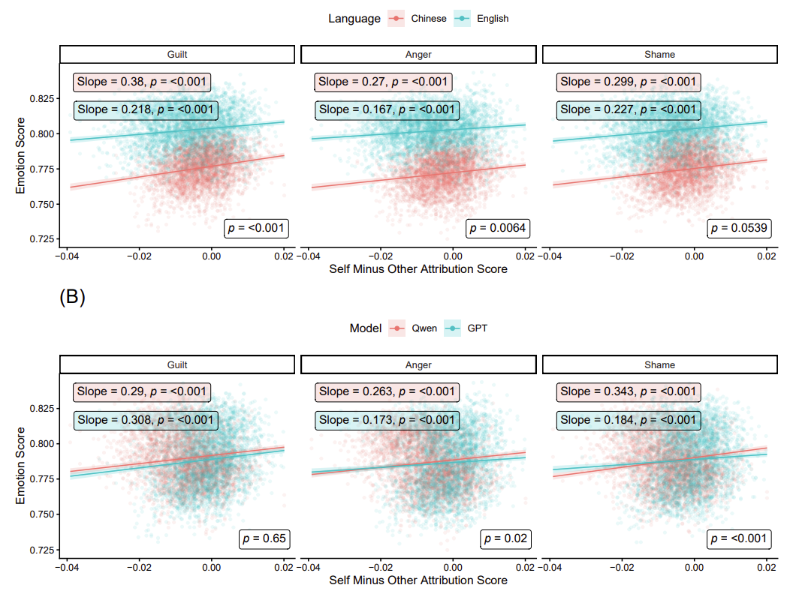

:::
:::


## Cultural bias results

- We found more evidence of Western biases than Eastern biases.

## Monologues: Cultural bias

::: panel-tabset

## Emotion levels

::: notes
We found evidence for an Eastern bias. In US vignettes, anger and shame levels are the same and guilt levels are higher than anger.
:::

*Evidence of an Eastern bias*

::: {layout="[[1,1],[1,1]]"}

::: {.card-2-compact}

**Predictions**

:::

::: {.card-2-compact}

**Results**

:::


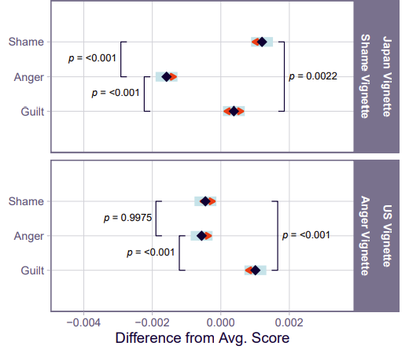

:::


## Attribution levels

::: notes

Again, we find no evidence of a cultural bias. Attribution other is lower in Japanese shame situations. Attribution other is higher in US anger situations.
:::

*Evidence of a Western bias*

::: {layout="[[1,1],[1,1]]"}

::: {.card-2-compact}

**Predictions**

:::

::: {.card-2-compact}

**Results**

:::


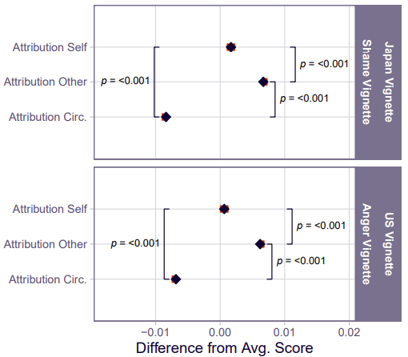
:::


## Humiliated fury

::: notes

We found evidence of a Western bias. For all conditions, there was a strong relationship between anger and shame. This means that all conditions exhibited humiliated fury.
:::

*Evidence of a Western bias*

::: {layout="[[1,1.4],[1,1.4]]"}

::: {.card-2-compact}

**Predictions**

:::

::: {.card-2-compact}

**Results**

:::


:::
:::

## Study 2 conclusions

##


::: columns

::: column

###### No support for cultural congruence

- English prompts resulted in higher scores across constructs.
- Qwen resulted in higher scores across constructs.
- No support for cultural congruence in monologues for any context.

:::

::: column

###### Western bias > Eastern bias

- 8/12 results supported a Western bias.
    - Attribution other > attribution self in Japanese shame vignettes.
    - Humiliated fury was present for all conditions.
- 3/12 results supported an Eastern bias.
    - Guilt > anger and shame = anger in US anger vignettes.
:::

:::

## Summary {data-name="Summary and Discussion" data-background-color="rgba(254, 248, 237, 1)"}


::: {.columns}

::: {.column}

#### Cultural congruence

- Ratings had more culturally-congruent responses than monologues.
- Within ratings, only emotion levels and attribution levels showed cultural congruence. Attribution levels showed more cultural congruence than emotion levels.


:::

::: {.column}

#### Cultural biases

- Ratings had comparable evidence for Eastern and Western biases.
- Monologues had more evidence for Western biases than Eastern biases.

:::

:::


## Discussion 
::: notes
- However, these findings of cultural alignment could be due to item selection and prompting. @sunFragilityCulturalTendencies2025 specifically criticizes @luCulturalTendenciesGenerative2025 for making a generalized claim. They also could not reproduce the results in @luCulturalTendenciesGenerative2025.

:::

- Our mixed findings regarding prompt language's effect on cultural congruence is more in line with @dudyAnalyzingCulturalRepresentations2024 than @luCulturalTendenciesGenerative2025.
- Our Western bias findings was not as strong and consistent like in the previous literature. This might be due to the limited ways in which we were able to formulate our predictions.

## Limitations

- Our extreme predictions for cultural biases in emotion and attribution levels may instead measure "LLM biases" and not true cultural tendencies.
- Our monologues results show some unexpected findings. For instance, emotion levels do not properly track attribution levels nor vignette type. This could suggest that our CCR results are invalid. 
- Not all Eastern biases are the same. A positive relationship between anger and shame could reflect humiliated fury existing at higher levels in China than Japan [@liangUnderstandingShameDrivenAggression2024;@liuLinkingPerceivedOverqualification2024].

## Future Studies

- Collect human monologues to more accurately assess for cultural bias.
- Manually annotate monologues
    - Validate CCR scores
    - Analyze the narrative style: Higher CCR scores for English monologues could be the result of a stronger narrative style characteristics of Western cultures [@blissPersonalNarrativesCultural2008].
- Analyze the cognitive style in the "thinking field": can a Western thinking style (intolerance of contradictions) explain the lack of association between anger and shame ratings [@nisbettCultureSystems2001]?

## Thank you!

## Ratings: model plots

::: panel-tabset

## Emotions

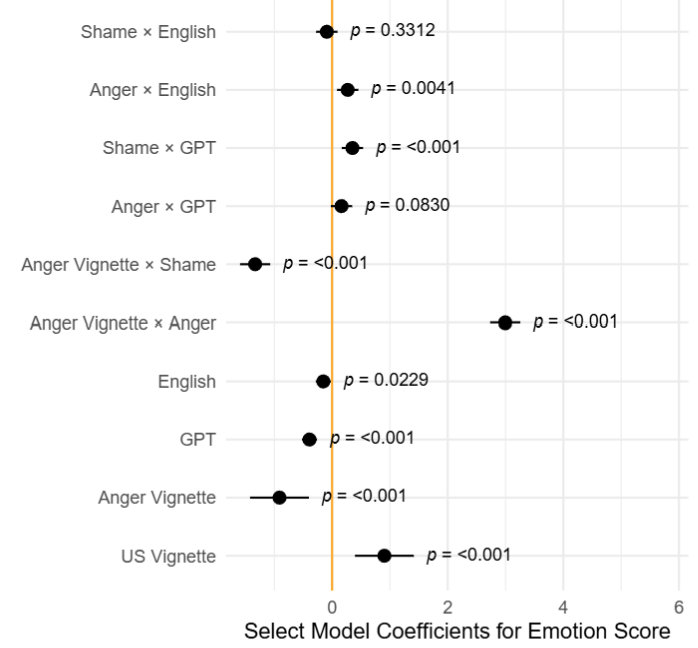

## Attributions

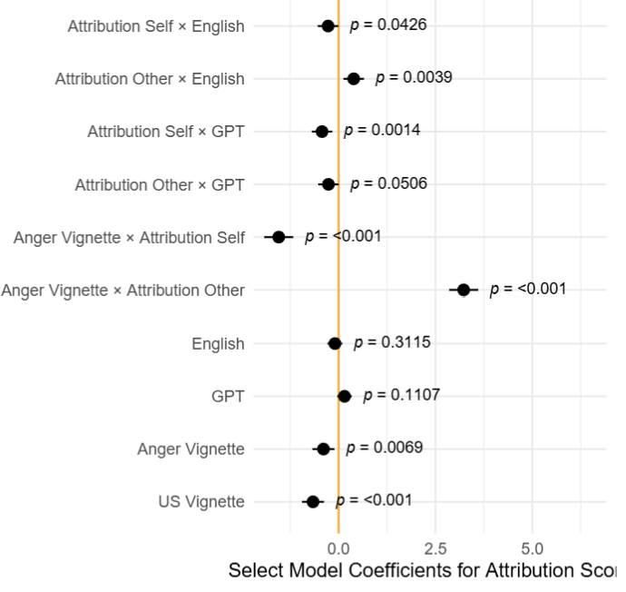

## Humiliated fury

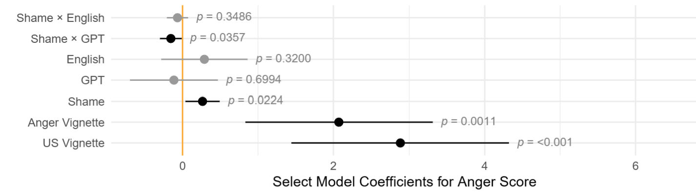

## Importance of attr.

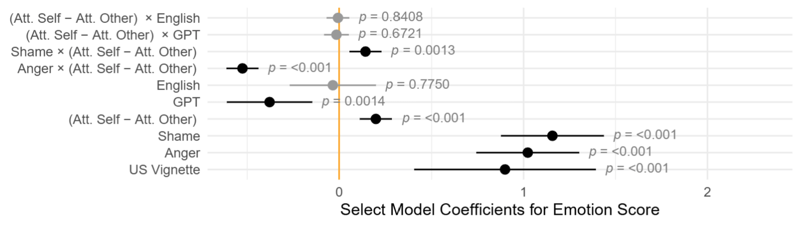

:::

## Monologues: Model plots

::: panel-tabset

## Emotions

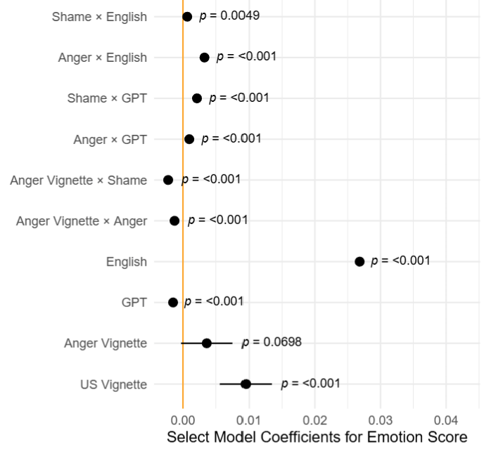

## Attributions

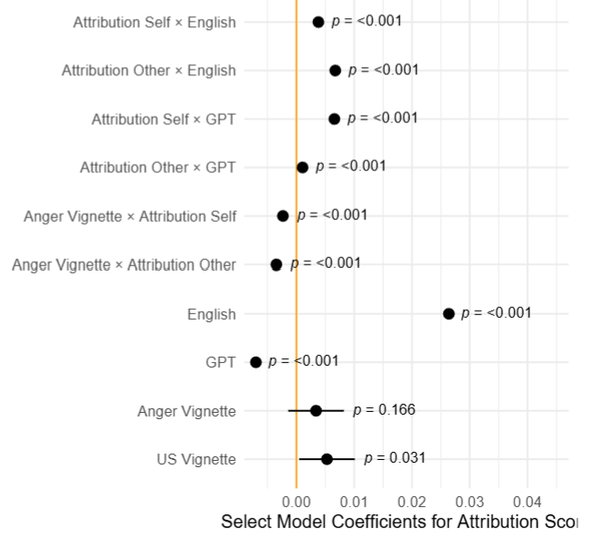

## Humiliated Fury

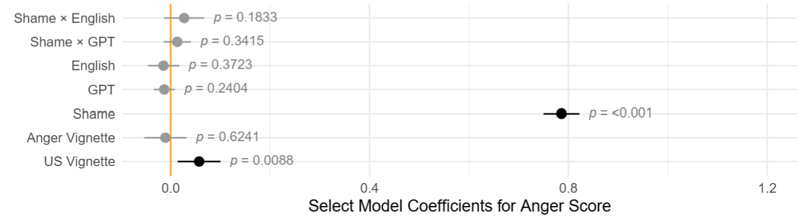

## Importance of attr.

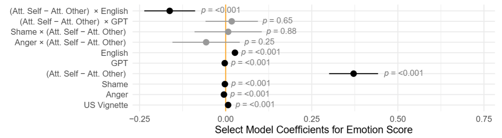
:::

## References