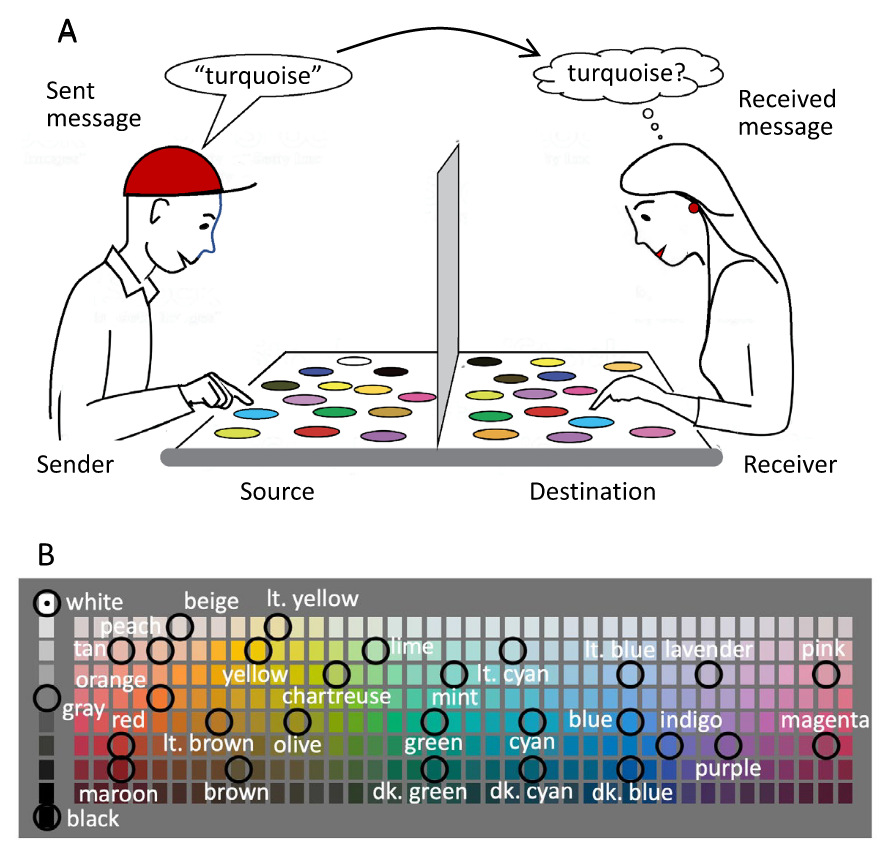
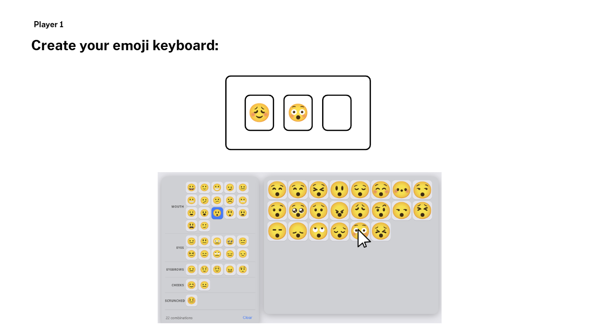
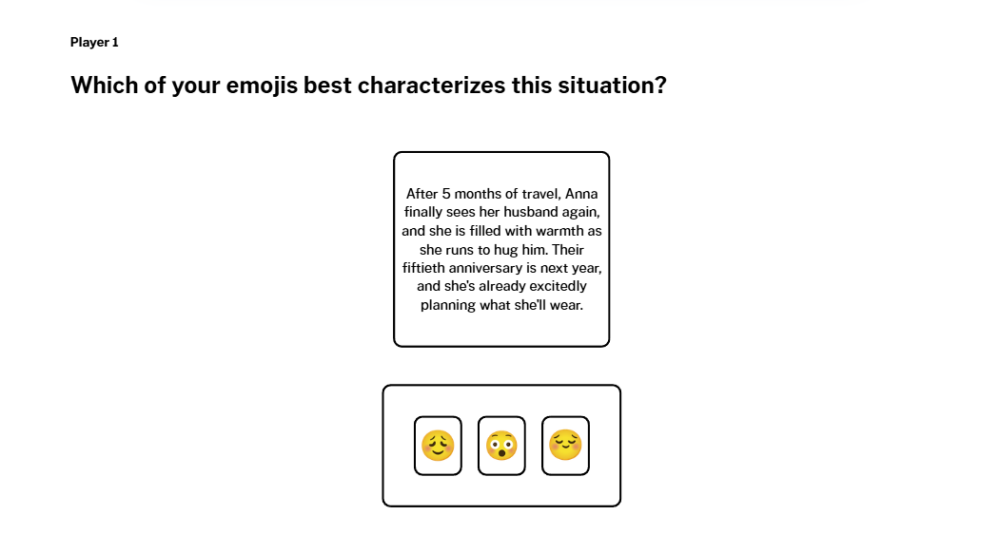
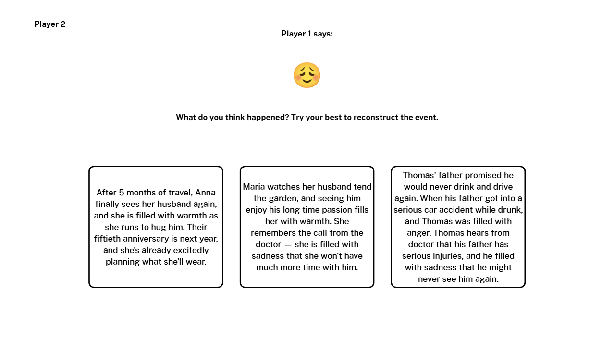
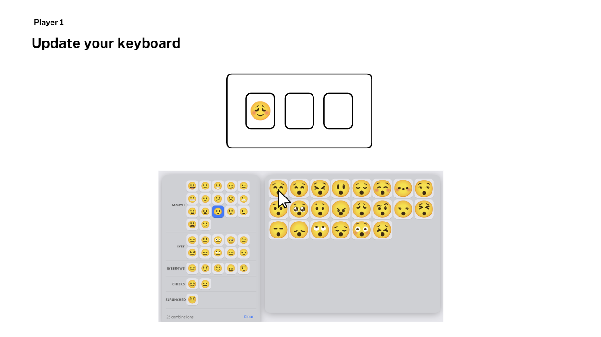

# Introduction {data-stack-name="Cultural differences in emotions"}

## When you think about love, what comes to mind? {background-color="rgba(253, 238, 244, 1)"}
1. It is a happy emotion, it's good to be reminded of those we love.
1. It is a sad emotion, it's often good to forget about those we loved.
1. It is about being dependent on others and desiring to be cared for.

::: notes
When you think of love, how would you describe this kind of emotion?
:::

## *Taru* {background-color="rgba(237, 251, 255, 1)"}

- Simbo word meaning both love and sadness

. . .

> “How can you have taru (love) without sore (sadness)? You love them; you think of all the awful things in their lives, all the hard times \[they will experience\].” - A Simbo woman

## *Okusunguwala* {background-color="oklch(0.904 0.0427 313.68)"}

- Luganda word for both anger and sadness

- Native Luganda speakers have a hard time distinguishing the English words “anger” and “sadness”

## *Afökho dödö* {background-color="rgba(255, 237, 228, 1)"}

- Nias word for anger, envy, offended, spite, resentment, malice, ill will

# Emotion colexification {background-color="oklch(0.9683 0.0688 87.6)"}

> Single word used to express multiple emotion meanings

::: notes
These are examples of colexifications, when one word is used to express multiple emotion meanings
:::

## Co-occurrence of Emotions?
Some possibilities:

::::: columns
::: {.column width="50%" height="20%"}
- **Love + sad**
  - No access to health care +  $\rightarrow$ loving feelings associated with worry
:::

::: {.column width="50%" height="20%"}
- **Sad + anger**
  - More interdependent relationships $\rightarrow$ anger feelings associated with losing valued relationships
:::
:::::

::: notes
- Give concrete examples

- If mothers from a certain culture are more worried that their children might become ill, then they may associate "loving" feelings with feelins of "sadness". This might happen more in populations with higher child-mortality rate.

- 
:::


## Studying color concepts provides insight into emotion concepts {data-stack-name="Color concepts" background-color="oklch(0.9415 0.0417 183.36)"}


::: footer
[@jacksonEmotionSemanticsShow2019]
:::

## Statistical regularities lead to color categories

- Number of lightness terms may be optimal based on the distribution of reflectances in the natural world.
- Compared to cool colors, wamer colors might be communicated more efficiently because objects tend to have warm colors.

::: footer
[@steelsCoordinatingPerceptuallyGrounded2005;  @baddeleyRelationshipLanguageEnvironment2009; @gibsonColorNamingLanguages2017]
:::

## Category games for colors

:::::: columns
::::: column

:::::

::::: column
- Broadly, in games games:
  - Speaker tries to communicate the color to the hearer using pre-existing category name or invented words. 
  - Result: generally some level population consensus. 

:::::
::::::

::: footer
[@contreraskallensCulturalEvolutionCategorization2018; @brownColorCommunicationGame2023]
:::

::: notes

@contreraskallensCulturalEvolutionCategorization2018
> The speaker is presented with a set of two or more color swatches, which she must discriminate. She chooses one and names it using either her preexisting category name or a new name invented to distinguish it from another presented swatch. The hearer then points to the color swatch to which he thinks the color name corresponds. If the hearer fails to correctly identify the correct swatch, he adds the transmitted word to his category discriminating the color interval in question. If there is agreement, the game is a ‘‘success,” and both individuals delete from their memories all of the words except the one transmitted from their inventories of words corresponding to the color category in question. The result is generally some sort of population-level consensus on category boundaries and corresponding labels.

:::

## Can we create a similar category game for emotions?

##
### Challenges studying emotion colexifications

1. Defining emotion space
    - Emotion space is much more complex than color space
    - How do we define statistical regularities?
1. Vocabulary for communicating emotion: 
    - How do you come up with an "in-between" emotion word when it doesn't exist yet?
    - Are imaginary words are harder to use in an emotion guesing game
        - In color games, you can use terms like "salmon"

# Emotion game {data-stack-name="Emotion game" background-color="oklch(0.9683 0.0688 87.6)"}

##

How do we look at statistical regularities in emotion space?

:::::: panel-tabset

## Just emotions

- Co-occurrence between two types of emotions
  - You feel both angry and sad.
  - You feel both love and sad.

## Emotions in context

1. Create a list of different types of contexts:
1. Produce different vignettes from combinations of them.

## Appraisals (just context)

- Co-occurrence of different types of appraisals, without mentioning specific emotions, or restrict to valence. 
- Possibly use Anna Wierzbicka's cognitive scenarios.

::::::

## Emotion vocabulary with emojis

##

:::::: panel-tabset


## Why emojis?
::: card-list
- Emojis are symbolic ways for people to communicate

- Yet it has potential to be much more continuous $\rightarrow$ easier to colexify

- 

  {height="250px" fig-align="center"}
:::

## More continuous emojis

::: card-list
- Our approach is similar to Emoji kitchen, except:
  - Puts all emoji on the same "level"
  - Makes emojis easier to find
- Creates an easy to use "emotion vocabulary"
:::

## Building emojis

::: {.iframe height="500px"}
emoji\emoji\_builder_static.html
:::
::::::

## Research question

- How do statistical regularities in emotion space impact the abstractness and distinctness of emoji use?

- Do the emojis used start off more random and eventually converge in the population?

# Study design

## Define an emotion space

## 4 emotional contexts

::: nonincremental
1. Warm feelings when seeing a person
1. Excited feelings when thinking about the future of a person
1. Sad feelings when thinking about losing a person
1. Angry feelings when person fails to meet important expectations

:::

## Co-occurrence

Define co-occurrence of emotional contexts, and assign to conditions

```{r}
#| fig-height: 3
#| fig-align: center
#| fig-alt: "Determines the probability that emotions are paired in each experimental conditions"

library(tidyverse)
library(ggplot2)

set.seed(123)
emotions <- c("Warm-see", "Excited-future", "Sad-lose", "Angry-disappoint")

binary_matrix <- function(n, r) {
 if (r > n) stop("r must be <= n")
  
  mat <- matrix(0, nrow = n, ncol = n)
  
  for (i in 1:n) {
    cols <- (((i + 1):(i + r)) - 1) %% n + 1
    mat[i, cols] <- 1/r
  }
  
  as.vector(mat)
}

x <- emotions
y <- emotions

data <- expand.grid(`Emotion 1`= y, `Emotion 2` = x)

# data <- data %>% mutate(Random = rep(1/3, times = 9), Intermediate = c(0,0.5,0.5,0.5,0,0.5,0.5, 0.5, 0), Deterministic = c(0,1,0,0,0,1,1,0,0)) %>% pivot_longer(cols=c("Random", "Intermediate", "Deterministic"), names_to = "Randomness", values_to = "Correlation")

data <- data %>% mutate(Random = binary_matrix(4,3), Intermediate = binary_matrix(4,2), Deterministic = binary_matrix(4,1)) %>% pivot_longer(cols=c("Random", "Intermediate", "Deterministic"), names_to = "Randomness", values_to = "Correlation")

ggplot(data, aes(y = `Emotion 1`, x = `Emotion 2`, fill=Correlation)) + geom_tile(colour = "white", linewidth = 1) + theme_minimal() + facet_grid(~Randomness) + theme(aspect.ratio = 1, strip.text = element_text(size = 16), axis.text.x = element_text(angle = 90, hjust=1, vjust=0.5)) + scale_y_discrete(limits=rev(emotions)) + scale_fill_gradient(low = "snow2", high = "dodgerblue")

```


## Create vignettes based on co-occurrence of contexts {.scrollable}


```{css}
#| echo: false

.reveal table {
  font-size: 11pt;
}

```

|Emotion 1|Emotion 2| Example Vignette|
|---|---|---|
|Warm feelings when seeing a person|Excited feelings when thinking about the future of a person|After 5 months of travel, Anna finally sees her husband again, and she is filled with warmth as she runs to hug him. Their fiftieth anniversary is next year, and she's already excitedly planning what she'll wear.|
|Warm feelings when seeing a person|Sad feelings when thinking about losing a person|Maria watches her husband tend the garden, and seeing him enjoy his long time passion fills her with warmth. She remembers the call from the doctor — she is filled with sadness that she won't have much more time with him.|
|...|...|...|
|Angry feelings when person fails to meet important expectations| Sad feelings when thinking about losing a person | Thomas' father promised he would never drink and drive again. When his father got into a serious car accident while drunk, and Thomas was filled with anger. Thomas hears from doctor that his father has serious injuries, and he filled with sadness that he might never see him again.|
|...|...|...|

# The game

## 



##



::: nonincremental

- Vignettes for each condition are chosen based on their co-occurrence matrix.

:::

##



##



## Scores

- This is a collaborative game, so scores for both players are the same.
- Scores are determined by how many emotion contexts player two got correctly. 
- If player 2 chooses a vignette with **one** correct emotion context type, they receive half a point.
- If player 2 chooses a vignette with **two** correct emotion context types, they receive one full point. 

## Predictions

- When co-occurrences are more deterministic, the emoji keyboard should include more distinct and specific emojis.
   - A single emoji is used for one type of event.
- When co-occurrences are more random, the emoji keyboard should include more abstract and gernalizable emojis.
  - A single emoji may be used for multiple types of events.
- In a single trial, changes to the emoji keyboard should decrease over time.

## Study design variation

1. Switch players every round to prevent easy conventions
   - If player 1 always encounters a new player two, will we find similar findings even though conventions are harder to develop?
1. Transmission chain
    - If the final keyboard from one game is given as the starting point to another set of participants, and we do this for multiple keyboards, will the keyboards from all these trials converge on the same one?

# Thank you!

## References {.scrollable}


